<div align="center">

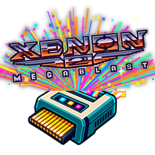

# Xenon 2 Megablast for the SidecarTridge Multi-device

[](https://github.com/sidecartridge/md-xenon-2/actions/workflows/build.yml)
[](https://github.com/sidecartridge/md-xenon-2/actions/workflows/release.yml)
[](LICENSE)

</div>

What if, in an alternative universe, Atari had put arcade-level graphics chips in our beloved
Atari ST? In 1989 The Bitmap Brothers released Xenon 2 Megablast, a shocking shoot'em up that ran
at 16.7 frames a second. In that parallel universe it runs at an insane **50**. Almost 40 years
later, a [SidecarTridge Multi-device](https://sidecartridge.com) in the cartridge slot of an
Atari ST, STE, Mega ST or Mega STE takes you there.

<p align="center">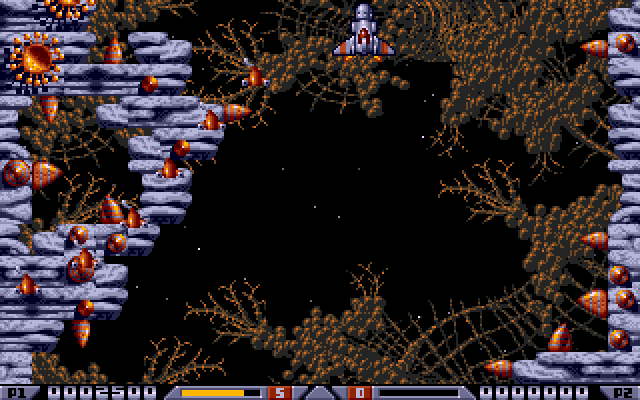</p>

This is the whole game, not a demo of it:

- all five levels, with their mid-level and end-of-level bosses
- Crispin's Swop Shop, with every weapon it sells
- David Whittaker's music and effects
- two players taking turns
- the high scores, now kept on the cartridge

Every rule is the original's, rewritten in C and checked frame by frame against the original
running in an emulator.

At 50 frames a second the world scrolls three times as fast, and you choose how the rest plays.
**The original's pace** keeps the ship, the shots and the enemies at the original's speed, drawn
smoothly in between. **×3** runs everything three times as fast: a different game altogether.
And with the frame rate at 17 and the cheats off it is the 1989 original, untouched.

The Raspberry Pi Pico (RP2040) in the cartridge runs the whole game and draws every frame. The
ST shows them, plays the sound and reads the joystick. On an STE or a Mega STE the title tune and
the shop's sample play through the DMA sound chip; elsewhere, and for the music and effects, the
YM2149 does the work.

## What you need

- **Your own copy of the original game.** Only the Image Works release on two disks works; the
  Kixx re-release is a different disk and is refused. None of the game is in this repository or
  in the firmware: the cartridge converts your copy. A preserved copy of the two disks, as Pasti
  `.stx` images, is at
  <https://www.atarimania.com/st/dumps/xenon_ii_-_megablast_imageworks.zip>.
- **A SidecarTridge Multi-device** and its microSD card. The disk images and what the cartridge
  converts from them take about 5 MB.
- **An Atari ST, STE, Mega ST or Mega STE** with a colour monitor, and a joystick in port 1.

## Quick start

1. Install Xenon 2 Megablast on the Multi-device from its app store.
2. Copy the two `.stx` disk images into the card's `XENON2` folder.
3. Put the card in the Multi-device and switch the ST on. The first start converts the disks
   and the five levels, once, with its progress on the screen. Later starts go straight to the
   title.
4. Fire or Space on the title starts the game's attract, O opens the options. Fire on the
   attract for SELECT: one or two players, the music on or off. Fire again to play.

<table>
  <tr>
    <td>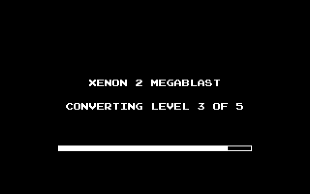</td>
    <td>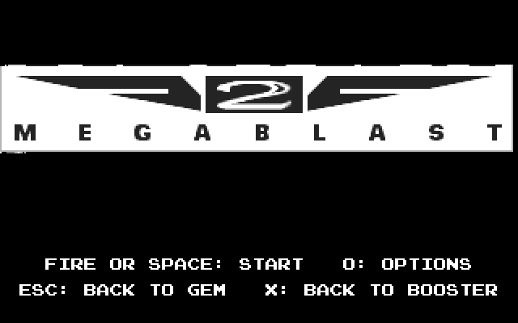</td>
  </tr>
  <tr>
    <td align="center">The first start converts the five levels, once</td>
    <td align="center">The title, and its keys</td>
  </tr>
  <tr>
    <td>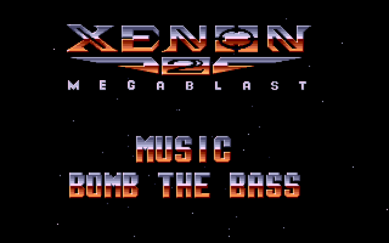</td>
    <td>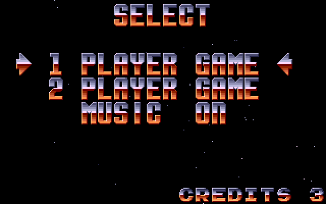</td>
  </tr>
  <tr>
    <td align="center">The attract: fire for SELECT</td>
    <td align="center">SELECT: one or two players, the music</td>
  </tr>
</table>

If the disks are not in the folder, or are another release, the screen says so and shows a QR
code to the instructions:

<p align="center">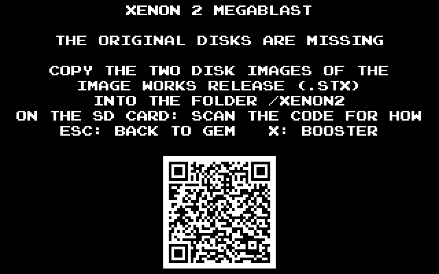</p>

## Keys

| Key | Where | What |
| --- | --- | --- |
| Joystick, fire | in play | fly and shoot (hold fire to keep shooting) |
| Space | in play | dive under the scenery, while dives last |
| P | in play | pause: fire or a key goes on |
| Esc | in play | back to the attract |
| O | title, attract | the options |
| Esc | title, attract | back to GEM |
| X | title, attract, options | back to the Multi-device's menu (Booster) |

## The options

Press O on the title or the attract. Each function key steps one option, and fire goes back.
Choices are kept on the cartridge. The app starts at 50 frames a second with the sprites at the
original's speed, and gives you a hand: a hit takes 1 from the shield, there are 5 lives and the
shots are ×3. F9 puts these defaults back.

<p align="center">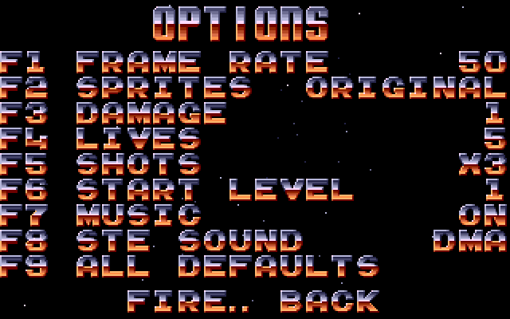</p>

| Key | Option | Values | Starts at |
| --- | --- | --- | --- |
| F1 | Frame rate | 17 (the original's) or 50: how fast the world scrolls | 50 |
| F2 | Sprites, at 50 | the original's speed, drawn smoothly in between, or ×3 | original |
| F3 | Damage | the shield a hit takes: the original's, 1, or none | 1 |
| F4 | Lives | 3, 5 or 9 | 5 |
| F5 | Shots | the ship's weapons at the original's speed or ×3 | ×3 |
| F6 | Start level | 1 to 5 | 1 |
| F7 | Music | on or off, as SELECT sets it | on |
| F8 | STE sound | the DMA sound chip or the YM, from the next reset | DMA |
| F9 | All defaults | every option back to the column on the right | |

## The game

<table>
  <tr>
    <td>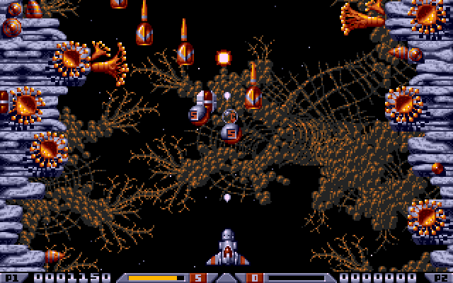</td>
    <td>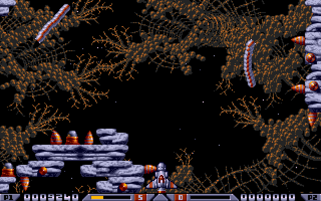</td>
  </tr>
  <tr>
    <td align="center">Level 1: the wall guns and the first waves</td>
    <td align="center">The worms, out of their holes</td>
  </tr>
  <tr>
    <td>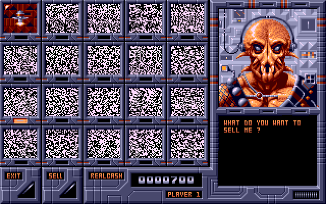</td>
    <td>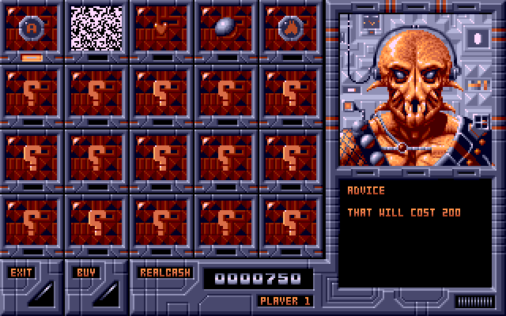</td>
  </tr>
  <tr>
    <td align="center">Crispin's Swop Shop: what will you sell?</td>
    <td align="center">And what will you buy?</td>
  </tr>
  <tr>
    <td>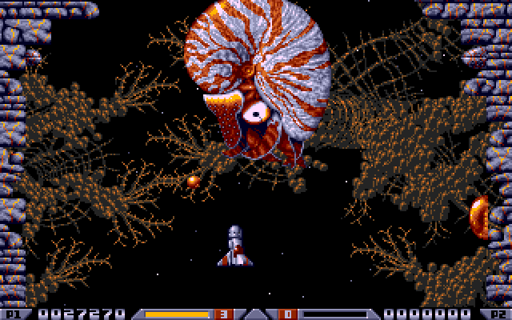</td>
    <td>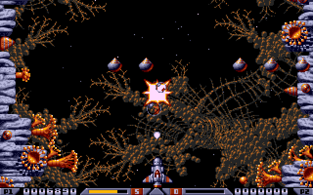</td>
  </tr>
  <tr>
    <td align="center">Level 1's end boss</td>
    <td align="center">Shots ×3 at work</td>
  </tr>
</table>

## Building it

```bash
# ./build.sh <board> <build_type> <app_uuid>
#   board:      pico_w
#   build_type: debug | release
#   app_uuid:   the app's UUID4 (desc/app.json); 44444444-4444-4444-8444-444444444444 for
#               local builds
./build.sh pico_w release 44444444-4444-4444-8444-444444444444
```

The firmware is `dist/<APP_UUID>-<VERSION>.uf2`. It needs the ARM GNU Toolchain 14.2
(`PICO_TOOLCHAIN_PATH`) and [atarist-toolkit-docker](https://github.com/sidecartridge/atarist-toolkit-docker)
(`stcmd`) for the ST's side. The first build clones the submodules (pico-sdk, pico-extras,
fatfs-sdk).

- `make -C tests/host test` runs the host tests: the game's logic, the converters and the
  framework's, on your computer in a few seconds. CI runs them and both builds on every pull
  request.
- `tools/x2conv` is the cartridge's converter on a computer. It makes the same set from the
  disk images and the images the cartridge keeps in its flash.
- `tools/re/` holds the tools that studied the original from the disks: a Pasti reader, a
  scripted Hatari harness, the extraction of the game and its levels. See
  [its README](tools/re/README.md). What they produce stays outside the repository.
- With a Raspberry Pi Debug Probe on the cartridge's SWD and debug UART, `tools/dev/` builds,
  flashes and checks the firmware, captures its console and reads the running game. See
  [`tools/dev/README.md`](tools/dev/README.md).

## How it is made

The app is built on [md-framebuffer-template](https://github.com/sidecartridge/md-framebuffer-template)
v1.1.0, whose framework does the ST's side. The frame the RP draws, one byte per pixel, is
converted to the ST's planes and copied to the screen every frame. The keyboard, the joystick
and the sound go through the cartridge.

The game itself was taken apart from its disks and rewritten in C, routine by routine, on the
RP2040. Every routine was checked against the original in the Hatari emulator, and the sound
driver write for write. No 68000 code of the game runs anywhere: the cartridge reads only the
game's data, its levels, pictures, songs and tables, from your disks.

[`CLAUDE.md`](CLAUDE.md) describes this repository's code, the framework's internals included.
The Multi-device's programming documentation is at
<https://docs.sidecartridge.com/sidecartridge-multidevice/programming/>.

## Acknowledgements

- **The Bitmap Brothers**, who designed the game; **The Assembly Line**, who wrote the Atari ST
  version; **Mark Coleman**, its graphics; **David Whittaker**, its music and effects; and
  **Image Works**, who published it in 1989.
- **[Hatari](https://www.hatari-emu.org)**, the emulator every routine was checked against.
- **[Atarimania](https://www.atarimania.com)**, for preserving the disks.
- **[QR Code generator](https://www.nayuki.io/page/qr-code-generator-library)** by Project Nayuki
  (MIT licence): the QR code to the instructions when the disks are missing
  (`rp/src/qrcodegen.c`, unchanged).
- **[md-framebuffer-template](https://github.com/sidecartridge/md-framebuffer-template)** and
  md-microfirmware-template by SidecarTridge: the framework this app is built on.

Xenon 2 Megablast belongs to its rights holders and is not part of this project: the app plays
the player's own copy of the disks.

## License

GPL v3.0: see [LICENSE](LICENSE).
